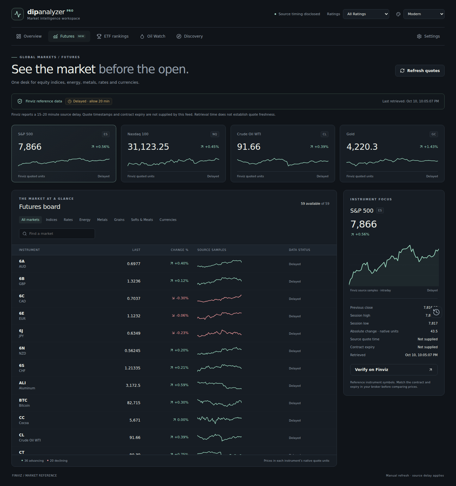
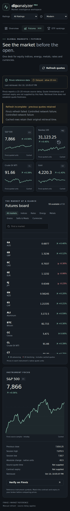

# Verification: futures and data integrity

Verified the final renderer changes with 52 native regression tests, clean ESLint, a production Vite build, and `git diff --check`. A fresh independent reviewer found no remaining Critical or Important issues after the fixes.

Browser checks with Playwright passed: all seven routes open without page errors; a recorded real-source response renders 59 futures instruments, including eight rate instruments; search preserves 103.6015625 bond-point precision; a failed refresh retains all 59 quotes as cached with the original retrieval time; a 390px viewport has no page-wide overflow. A separate integration check confirms Strong Sell entries remain under the combined sell filter, dashboard/detail score agreement, and chart-range independence. An alert regression first reproduced two audio contexts and no cleanup under React StrictMode, then passed with exactly one context and one close.

Six TradingView regressions check shared script loading, bounded timeout and retries, stale AAPL-to-MSFT cancellation, and consumer cleanup. Dashboard auto-refresh now skips an active scan rather than continually interrupting large scans.

Live source checks separately confirmed HTTP 200 and 59 instruments from Finviz `api/futures_all?timeframe=i5`, plus valid current stock/ETF tables from views 111, 141, and 161 (20 parsed rows each). These checks do not prove continuous provider availability or quote freshness. Finviz's source quote timestamp and contract expiry are absent; the app does not invent them.

The screenshots below show a recorded Finviz reference response used by the UI regression suite, not current market quotes. The mobile image shows the deliberately exercised cached-failure state.

A native Electron installer was not built or run in this environment. The installed package did not include the Electron executable because npm install scripts were not enabled. Renderer, browser, and source validations above are the checks performed; installer verification remains a target-platform step.
